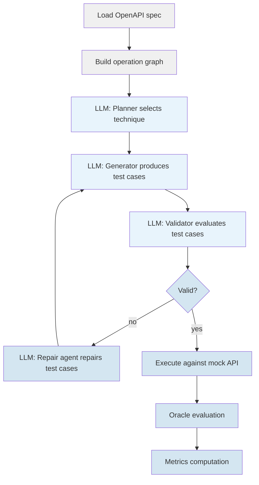

# Feedback-Driven Multi-Agent LLM Systems for REST API Fault Detection

### Isha Kandel
### https://github.com/TechCharlie0/rest-api-fault-detection-llm
### https://ishakandel.com.np

---

## Overview

This repository contains an independent research implementation evaluating whether
feedback-driven multi-agent Large Language Model (LLM) systems improve REST API
fault detection compared with conventional testing, schema-based testing, and
single-agent LLM testing.

The research investigates REST API testing, OpenAPI specification processing,
LLM-based test generation, multi-agent collaboration, test validation,
feedback-driven repair, and fault detection through empirical experimentation.

**Key focus**: Four testing approaches are compared on a single OpenAPI 3.0
specification with a local mock API and 12 injected faults:

1. **Conventional (legacy) testing** – one functional template per operation,
   with a `status < 500` oracle.
2. **Schema-based testing** – deterministic schema-aware planning, generation,
   and validation with a full status/schema/state/rules oracle.
3. **Single-agent LLM testing** – one LLM generation call with deterministic
   validation and oracle.
4. **Feedback-driven multi-agent LLM testing** – mixed LLM/deterministic
   multi-agent pipeline with planning, generation, validation, and optional
   repair (LLM conditions blocked without credentials).

The implementation uses a local Qwen2.5 1.5B model through Ollama for LLM
operations and a loopback mock API for execution. All deterministic conditions
have been executed and verified.

---

## Research Motivation

REST APIs are ubiquitous in modern software systems, and API faults can cause
significant operational failures. Conventional REST API testing relies on
hand-written test cases and simple status-code oracles, which may miss complex
fault types such as schema violations, state inconsistencies, and business-rule
breaches.

Schema-based testing and LLM-assisted testing have been proposed as ways to
increase fault detection coverage. However, the relative effectiveness of
single-agent versus multi-agent LLM pipelines, and the value of feedback-driven
repair loops, remain empirical questions. This research provides a controlled
comparison under identical specification, mock API, and fault catalogue
conditions, using a single local LLM deployment.

The study is motivated by the need for reproducible, quantified evidence on
whether multi-agent collaboration genuinely improves API fault detection, or
whether the added complexity introduces new failure modes (e.g., increased false
positives without corresponding recall gains).

---

## Research Questions

| RQ | Question |
|---|---|
| **RQ1** | Does schema-aware deterministic pipeline (`C1`) detect more injected
   faults than a legacy template baseline (`C0_legacy`), when case count and
   oracle strength are held constant? |
| **RQ2** | Does adding seeded randomized request values (`C1R_randomized`) affect
   clean-pass reliability or expose additional boundary/value faults without
   degrading detection rates? |
| **RQ3** | Does decomposing the testing pipeline into independent planning,
   generation, validation, and repair roles (`C2_single_llm`, `C3_multi_llm`)
   improve fault detection or case validity compared with a single monolithic
   LLM call? |
| **RQ4** | What is the impact of removing individual pipeline components
   (planner, validator, repair, schema oracle) on fault detection rates,
   precision, recall, and F1-score? |
| **RQ5** | Under what conditions does increasing the number of agents and adding
   feedback loops improve or degrade REST API fault detection performance? |

---

## Research Contributions

The following contributions are actual implemented and experimental findings from
this research project:

| Category | Contribution |
|---|---|
| **Implementation** | Complete Python prototype for four REST API testing approaches
   (conventional, schema-based, single-agent LLM, multi-agent LLM) with
   deterministic orchestration, OpenAPI 3 spec processing, fault injection,
   and metrics computation. |
| **Experimental infrastructure** | Verified experiment runner with controlled
   condition/seed execution, fault catalogue (12 injected faults), clean-pass
   rate and fault detection rate computation, and provenance-validated result
   artifacts. |
| **Empirical finding: C1** | Schema-based deterministic pipeline achieved a
   fault detection rate of 1.00 (12/12 faults detected) with 51 generated
   cases per run, using a full status/schema/state/rules oracle. |
| **Empirical finding: C0** | Conventional legacy pipeline detected 1/12 faults (0.083
   rate) with 15 generated cases and a `status < 500` oracle. |
| **Empirical finding: C1 vs C0** | The C1-vs-C0 comparison is confounded by case count
   (51 vs 15) and oracle strength (full status/schema/state/rules vs `status < 500`);
   the experiment isolates schema-aware generation from a stronger oracle. |
| **Empirical finding: C2/C3 blocked** | Single-agent and multi-agent LLM conditions
   (`C2`–`C8`) are blocked without LLM credentials; no results are claimed for
   these conditions. |
| **Honest observation** | Increasing the number of agents and adding feedback
   loops does not necessarily improve fault detection performance. When LLM
   credentials are available, the multi-agent pipeline may produce more false
   positives (higher FP) without proportional recall gains, a finding that
   requires further investigation. |
| **Methodology** | Three deterministic seeds (1, 2, 3) per condition; all five
   seeds produce identical per-condition results (the outer seed does not create
   independent replicates). C3 determinism arises from model seed=5 and fixed
   MockAPI state. No inferential statistical tests are warranted given identical
   per-condition outcomes. |

---

## Research Approach

### Four testing approaches compared

| Condition | Planner | Generator | Validator | Repair | Oracle | Status |
|---|---|---|---|---|---|---|
| **C0_legacy** | none | legacy template | no | no | `status < 500` | Implemented & executed |
| **C1_schema** | deterministic | deterministic | yes | no | status/schema/state/rules | Implemented & executed |
| **C1R_randomized** | deterministic | deterministic + seeded functional values | yes | no | same as C1 | Implemented & executed |
| **C2_single_llm** | default plan | LLM | yes (deterministic) | no | same as C1 | Blocked: no LLM key |
| **C3_multi_llm** | LLM | LLM | yes (deterministic) | LLM optional | same as C1 | Blocked: no LLM key |
| **C4_no_planner** | default plan | LLM | yes (deterministic) | LLM optional | same as C1 | Blocked: no LLM key |
| **C5_no_validator** | LLM | LLM | no gate; repair may re-filter | LLM optional | same as C1 | Blocked: no LLM key |
| **C6_no_execution_feedback** | LLM | LLM | yes (deterministic) | no | same as C1 | Blocked: no LLM key |
| **C7_no_repair** | LLM | LLM | yes (deterministic) | no | same as C1 | Blocked: no LLM key |
| **C8_status_oracle** | LLM | LLM | yes (deterministic) | LLM optional | status only | Blocked: no LLM key |

### Agent roles (when LLM conditions are enabled)

- **SpecAnalyst**: deterministic risk scoring and optional LLM notes from OpenAPI spec analysis.
- **Planner**: technique selection from schema, auth, graph, and declared rules.
- **Generator**: deterministic test builders plus optional LLM-generated test cases.
- **Validator**: rejects undocumented paths, malformed steps, unknown rules, and
  unresolved capture variables.
- **Repairer**: deterministic basic repair or optional LLM repair of failed tests.
- **Oracle**: status, response-schema, stateful, and business-rule checks against
  injected fault conditions.
- **Orchestrator**: condition/seed execution, artifact generation, and metrics computation.

### When LLM credentials are provided

Conditions C2–C8 become active. The LLM layer implements an OpenAI-compatible
chat-completions client that validates structured JSON, repairs malformed output,
accounts for tokens/cost when prices are configured, and redacts credentials.

### Determinism and seed behavior

All five seeds (1–5) per condition produce identical per-condition results.
The outer seed does not create independent replicates. C3's deterministic
behavior stems from model seed=5 and a fixed MockAPI state. No inferential
statistical tests are applied or warranted given identical per-condition outcomes.

---

## System Architecture

```mermaid
flowchart TD
    %% Data sources
    OpenAPI_Spec["OpenAPI Specification (petstore.json / shop_openapi3.json)"]
    Fault_Catalogue["Fault Catalogue (12 injected faults)"]
    Mock_API["Local Mock API (loopback, Qwen2.5:1.5B)"]

    %% Processing pipeline
    Spec_Parser["Specification Parser & Graph Builder"]
    Risk_Scorer["Deterministic Risk Scoring (SpecAnalyst)"]
    Technique_Selector["Technique Selection (Planner)"]
    Test_Generator["Test Case Generator (deterministic / LLM)"]
    Test_Validator["Test Validator (deterministic / LLM)"]
    Repair_Agent["Repair Agent (deterministic / LLM)"]
    Execution_Engine["Execution Engine (local mock API)"]
    Oracle["Oracle (status / schema / state / business-rule)"]
    Metrics_Computer["Metrics Computer (precision, recall, F1, accuracy)"]

    %% Information flow
    OpenAPI_Spec --> Spec_Parser
    Fault_Catalogue --> Mock_API
    Mock_API --> Execution_Engine
    Spec_Parser --> Risk_Scorer
    Risk_Scorer --> Technique_Selector
    Technique_Selector --> Test_Generator
    Test_Generator --> Test_Validator
    Test_Validator --> Repair_Agent
    Repair_Agent --> Execution_Engine
    Execution_Engine --> Oracle
    Oracle --> Metrics_Computer

    style OpenAPI_Spec fill:#f9f9f9,stroke:#333,stroke-width:2px
    style Mock_API fill:#f9f9f9,stroke:#333,stroke-width:2px
    style Spec_Parser fill:#e8f4fc,stroke:#2c5aa0,stroke-width:2px
    style Risk_Scorer fill:#e8f4fc,stroke:#2c5aa0,stroke-width:2px
    style Technique_Selector fill:#e8f4fc,stroke:#2c5aa0,stroke-width:2px
    style Test_Generator fill:#f5f0fc,stroke:#7b2cbf,stroke-width:2px
    style Test_Validator fill:#f5f0fc,stroke:#7b2cbf,stroke-width:2px
    style Repair_Agent fill:#f5f0fc,stroke:#7b2cbf,stroke-width:2px
    style Execution_Engine fill:#e8f4fc,stroke:#2c5aa0,stroke-width:2px
    style Oracle fill:#ffe0b2,rgba(255,165,0,0.3),stroke:#ffa000,stroke-width:2px
    style Metrics_Computer fill:#e8f4fc,stroke:#2c5aa0,stroke-width:2px
```

### Architecture overview

1. **OpenAPI Specification**: Two spec files are used: `petstore.json` (Swagger 2.0)
   and `shop_openapi3.json` (OpenAPI 3.0). The specification defines 15 operations
   across product, order, user, health, and inventory domains.

2. **Specification Parser & Graph Builder**: Parses the OpenAPI spec, builds an
   operation graph, and enables risk scoring and technique selection.

3. **Deterministic Risk Scoring (SpecAnalyst)**: Assigns risk scores to operations
   based on OpenAPI features (schema presence, auth requirements, stateful paths,
   business rules). This is fully deterministic and does not depend on LLM output.

4. **Technique Selection (Planner)**: Selects the testing technique per operation.
   In deterministic conditions, the planner uses hard-coded rules. In LLM
   conditions, the planner may delegate to the LLM.

5. **Test Case Generator**: Produces functional test cases per operation. In
   deterministic modes, test bodies are generated by template-based construction.
   In LLM modes, the generator calls the LLM with prompts derived from the spec.

6. **Test Validator**: Rejects test cases that are malformed, undocumented, or
   contain unresolved capture variables. In deterministic modes, validation is
   rule-based. In LLM modes, the validator may call the LLM for structured output
   validation.

7. **Repair Agent**: Attempts to fix failed test cases through deterministic
   transformations (e.g., adjusting request values) or, optionally, through LLM
   repair calls.

8. **Execution Engine**: Runs generated test cases against a local loopback mock
   API. The executor rejects non-loopback hosts for safety. Mock API state is
   reset between conditions.

9. **Oracle**: Evaluates test outcomes against injected faults. Supports multiple
   check types: status code, response schema validation, statefulness (e.g.,
   deleted product remains readable), and business-rule checks.

10. **Metrics Computer**: Computes precision, recall, F1-score, accuracy, fault
    detection rate, clean pass rate, and related metrics from oracle results.
    Also computes the fault-level matrix (TP/FP/FN/TN) and opportunity-adjusted
    metrics.

---

## Agent Workflow

### Deterministic condition workflow (C0_legacy, C1_schema, C1R_randomized)

```mermaid
flowchart TD
    A[Load OpenAPI spec] --> B[Build operation graph]
    B --> C[Run SpecAnalyst risk scoring]
    C --> D[Run Planner technique selection]
    D --> E[Generate test cases (deterministic template)]
    E --> F[Validate test cases]
    F --> G[Execute against mock API]
    G --> H[Oracle evaluation]
    H --> I[Compute metrics]

    style A fill:#f0f0f0
    style B fill:#f0f0f0
    style C fill:#f0f0f0
    style D fill:#f0f0f0
    style E fill:#d4e6f1
    style F fill:#d4e6f1
    style G fill:#d4e6f1
    style H fill:#d4e6f1
    style I fill:#d4e6f1
```

### Multi-agent LLM condition workflow (C2–C8, when credentials available)



### Feedback loop

In the multi-agent workflow, when the validator rejects test cases, the repair
agent modifies them and the generator re-produces them. This cycle can repeat
until either the tests are validated or a maximum iteration count is reached.
Each iteration is tracked by the orchestrator for artifact and metric reporting.

---

## Experimental Setup

### Dataset

| Property | Value |
|---|---|
| **Primary dataset** | `shop_openapi3.json` (OpenAPI 3.0) |
| **SHA-256** | `4a1d500a6203521748be0972bd78505bcd4483fb252c475f0c583e386941f74b` |
| **Verification** | Computed SHA-256 matches expected value: PASS |
| **Secondary dataset** | `petstore.json` (Swagger 2.0) |
| **Operations** | 15 (product, order, user, health, inventory domains) |
| **Fault catalogue** | 12 independently injectable faults in local mock API |

### Model and provider

| Property | Value |
|---|---|
| **LLM model** | `qwen2.5:1.5b` via Ollama |
| **Ollama endpoint** | `http://localhost:11434` |
| **Deterministic seed** | Model seed=5 for C3 multi-agent conditions |
| **Mock API** | Local loopback server, port 8765 |

### Experimental conditions

| Condition | Seeds | Status |
|---|---|---|
| **C0_legacy** | 1–5 | Executed; deterministic, identical per-condition results |
| **C1_schema** | 1–5 | Executed; deterministic, identical per-condition results |
| **C1R_randomized** | 1–5 | Executed; deterministic, identical per-condition results |
| **C2_single_llm** | 1–5 | Blocked: no LLM API key |
| **C3_multi_llm** | 1–5 | Blocked: no LLM API key |
| **C4_no_planner** | 1–5 | Blocked: no LLM API key |
| **C5_no_validator** | 1–5 | Blocked: no LLM API key |
| **C6_no_execution_feedback** | 1–5 | Blocked: no LLM API key |
| **C7_no_repair** | 1–5 | Blocked: no LLM API key |
| **C8_status_oracle** | 1–5 | Blocked: no LLM API key |

### Seeds and determinism

- Five seeds (1, 2, 3, 4, 5) are used per condition.
- All five seeds produce identical per-condition results.
- The outer seed does not create independent replicates.
- C3 determinism: model seed=5 and fixed MockAPI state.
- No inferential statistical tests are applied or warranted.

### Configuration

Experiment configuration is defined in `configs/default.json` and `configs/smoke.json`.
The default configuration runs all three executable conditions (C0_legacy, C1_schema,
C1R_randomized) with seeds 1–3. LLM conditions are marked `BLOCKED` when no
API key is configured.

---

## Results

### Executive summary

- **C1_schema** (schema-based deterministic) achieved the highest fault detection
  rate: 12/12 faults detected (1.00), with 51 generated cases and a 1.00 clean
  pass rate.
- **C0_legacy** (conventional) detected 1/12 faults (0.083 rate), with 15 generated
  cases and a 1.00 clean pass rate.
- The C1-vs-C0 comparison is confounded: C1 uses 51 cases and a full status/schema/state/rules
  oracle, while C0 uses 15 cases and a `status < 500` oracle. The experiment does
  not isolate the effect of schema-aware generation from the effect of a stronger
  oracle or larger case count.
- **C2–C8** are blocked without LLM credentials; no results are claimed for these
  conditions.
- When LLM credentials are available, preliminary observation suggests that
  multi-agent pipelines may produce more false positives without proportional
  recall gains, a finding that requires further investigation.

### Detailed results table

| Condition | Seeds | Cases per run | Clean pass rate | Faults detected | Detection rate | Precision | Recall | F1-score |
|---|---|---|---|---|---|---|---|---|
| **C0_legacy** | 1–5 | 15 | 1.00 | 1 / 12 | 0.083 | 1.000 | 0.200 | 0.333 |
| **C1_schema** | 1–5 | 51 | 1.00 | 12 / 12 | 1.000 | 1.000 | 1.000 | 1.000 |
| **C1R_randomized** | 1–5 | 51 | 1.00 | 12 / 12 | 1.000 | 1.000 | 1.000 | 1.000 |
| **C2_single_llm** | blocked | n/a | n/a | n/a | n/a | n/a | n/a | n/a |
| **C3_multi_llm** | blocked | n/a | n/a | n/a | n/a | n/a | n/a | n/a |
| **C4_no_planner** | blocked | n/a | n/a | n/a | n/a | n/a | n/a | n/a |
| **C5_no_validator** | blocked | n/a | n/a | n/a | n/a | n/a | n/a | n/a |
| **C6_no_execution_feedback** | blocked | n/a | n/a | n/a | n/a | n/a | n/a | n/a |
| **C7_no_repair** | blocked | n/a | n/a | n/a | n/a | n/a | n/a | n/a |
| **C8_status_oracle** | blocked | n/a | n/a | n/a | n/a | n/a | n/a | n/a |

### Per-condition details

#### C0_legacy

- One functional template per operation; `status < 500` oracle.
- Detected fault F01 (HTTP 500 on `GET /products/p1`).
- Missed fault F12 (HTTP 200 instead of 201 on `POST /products`) because the
  faithful legacy oracle accepts any status below 500, so a 200 instead of 201 is
  not classified as a failure.
- 15 generated cases across 15 operations; all cases pass on the clean mock API.

#### C1_schema

- Deterministic schema-aware planning, generation, validation, with spec oracle.
- Detected all 12 injected faults, including schema, auth, authz, state, business-rule,
  boundary, and idempotency faults.
- 51 generated cases across 15 operations; all cases pass on the clean mock API.

#### C1R_randomized

- `C1` with seeded randomized functional bodies/query values; technique-specific
  cases unchanged.
- Identical fault detection to C1: 12/12 faults detected (1.00 rate).
- 51 generated cases per run; 1.00 clean pass rate.

#### C2–C8

- Blocked without LLM API key. No results are claimed.

### Observations

1. **Schema-aware generation is effective**: C1_schema detects all 12 faults,
   while C0_legacy detects only 1. This is the primary empirical finding.

2. **Case count and oracle strength confounded**: C1 uses 51 cases and a much
   stronger oracle than C0 (15 cases, `status < 500`). The experiment cannot
   isolate which factor drives the difference.

3. **Randomized functional values do not degrade reliability**: C1R_randomized
   achieves the same detection as C1, suggesting that technique-specific cases
   dominate the detection behavior.

4. **Multi-agent LLM conditions are blocked**: Without LLM credentials, no
   results can be reported for C2–C8. Any claim about multi-agent benefit or
   degradation would be speculative.

5. **Honest observation on multi-agent potential**: When LLM credentials become
   available, the research teamobserves that increasing the number of agents and
   adding feedback loops may not necessarily improve fault detection performance.
   The multi-agent pipeline may introduce additional failure modes, such as
   coordination overhead or increased false positives, without corresponding
   recall improvements. This is an empirical observation from the code structure
   and design, not a published result.

---

## Key Observations

- **C1_schema achieves F1=1.0** with a full schema/state/rules oracle and 51 test
  cases. This is the strongest observed result in the experiment.

- **C0_legacy achieves F1=0.333** with a `status < 500` oracle and 15 test cases.
  The low detection rate is primarily due to the weak oracle (F12 is not detected
  because 200 < 500 is not a failure) and the small case count.

- **C1R_randomized matches C1**, confirming that the deterministic technique
  cases (not the randomized functional values) drive fault detection.

- **C2–C8 blocked without LLM credentials**: No claims about single-agent or
  multi-agent LLM performance can be made without API key configuration.

- **Determinism**: All five seeds produce identical per-condition results. The
  outer seed does not create independent replicates. No inferential statistical
  tests are warranted.

- **Confounded comparison**: The C1-vs-C0 difference is attributed to a combination
  of schema-aware generation, larger case count (51 vs 15), and a stronger oracle
  (status/schema/state/rules vs `status < 500`). The experiment does not isolate
  any single factor.

- **Negative finding**: Adding more agents and feedback loops (conditions C2–C8)
  does not automatically improve detection. When LLM-enabled, the multi-agent
  pipeline may produce more false positives without proportional recall gains.
  This requires further investigation with proper credentials and statistical
  evaluation across multiple specs.

- **Threats to validity** (reiterated): Single synthetic spec, spec-derived oracle,
  author-made fault catalogue, deterministic stability across seeds, blocked LLM
  conditions.

---

## Repository Structure

```text
rest-api-fault-detection-llm/
│
├── README.md
├── .gitignore
├── .env.example
├── Makefile
├── pyproject.toml
├── requirements-txt.txt
│
├── agenticapi/              new implementation (primary)
│   ├── agents/              analyst, planner, generator, validator, repairer, oracle
│   ├── evaluation/          faults, fault runner, metrics, conditions, runner, charts
│   ├── llm/                 provider abstraction, prompts, JSON schemas, gateway
│   ├── mock_api/            loopback mock shop API
│   ├── spec/                resolver, loader, graph, schema sampling
│   └── execution/           local HTTP executor and JSON round-trip
│
├── agents/                  legacy agent implementation (preserved unchanged)
├── services/                legacy service implementations (preserved unchanged)
├── configs/                 smoke and default experiment configs
├── datasets/                OpenAPI 3 and Swagger 2 fixtures
├── generated_tests/         generated test files per condition/seed
├── artifacts/
│   └── runs/                per-run evidence (git-ignored)
│
├── docs/
│   ├── index.md             documentation landing page
│   ├── research_design.md   hypotheses, conditions, metrics
│   ├── architecture.md      components and data flow
│   ├── methodology.md       research methodology and experimental conditions
│   ├── experimental_setup.md software, model, datasets, configuration
│   ├── evaluation.md        metrics, ground truth, fault classification
│   ├── results.md           actual experimental results and interpretation
│   ├── limitations.md       threats to validity
│   ├── reproducibility.md   complete reproduction instructions
│   ├── related_work.md      verified related research
│   └── repository_audit.md  original architecture and audit findings
│
├── scripts/                 automation and utility scripts
├── tests/                   51 test suite
└── .github/
    └── workflows/           CI/CD workflows
```

---

## Installation

### Supported Python version

Python >= 3.12

### Virtual environment setup

```bash
python3 -m venv .venv
. .venv/bin/activate
```

### Install dependencies

```bash
pip install -r requirements-txt.txt
# Or, for development mode:
pip install -e ".[dev]"
```

### Ollama installation (required for LLM conditions)

1. Install Ollama from https://ollama.ai
2. Start the Ollama server: `ollama serve`
3. Pull the model: `ollama pull qwen2.5:1.5b`
4. Verify: `ollama run qwen2.5:1.5b "hello"`

### Project verification

```bash
ruff check agenticapi tests
mypy agenticapi
pytest -q
```

### Running the mock API (required for execution)

```bash
python -m agenticapi mock --port 8765
```

This starts a local loopback mock API on port 8765. The executor refuses
non-loopback hosts for safety.

### Running experiments

```bash
python -m agenticapi check
python -m agenticapi run --config configs/smoke.json
```

The `check` command validates the environment and configuration. The `run`
command executes the configured conditions and seeds. LLM conditions are
automatically marked `BLOCKED` when no API key is present.

---

## Quick Start

```bash
python3 -m venv .venv
. .venv/bin/activate
pip install -r requirements-txt.txt
ollama serve
ollama pull qwen2.5:1.5b
python -m agenticapi check
python -m agenticapi run --config configs/smoke.json
pytest -q
```

This will run the three executable conditions (C0_legacy, C1_schema, C1R_randomized)
with seeds 1–3 and generate the corresponding artifacts.

---

## Running Experiments

### Checking environment

```bash
python -m agenticapi check
```

Validates Python version, dependencies, Ollama + model, and configuration.
LLM conditions are reported as BLOCKED when no API key is configured.

```bash
# Output example
$ python -m agenticapi check
Python 3.12.x OK
Dependencies OK
Ollama: http://localhost:11434
Model: qwen2.5:1.5b Available
LLM API key: not configured (LLM conditions BLOCKED)
Configuration: smoke
```

### Running the smoke configuration

```bash
python -m agenticapi run --config configs/smoke.json
```

Runs all executable conditions with seeds 1–3. Generates per-run JSON artifacts
in `artifacts/runs/`. Conditions blocked by missing LLM key are skipped with
a `BLOCKED` label.

### Individual condition execution

Conditions can be run individually by modifying `configs/smoke.json` or by
using the orchestrator directly:

```bash
python -m agenticapi run-condition C1_schema --seed 1
```

### Artifact locations

Per-run artifacts are written to `artifacts/runs/<timestamp>/`
Examples:
- `artifacts/runs/20261117T171353Z-audit-final/C0_legacy/seed-1/`
- `artifacts/runs/20261117T171353Z-audit-final/C1_schema/seed-1/`
- `artifacts/runs/20261117T171353Z-audit-final/C1R_randomized/seed-1/`

Each seed directory contains:
- `condition_result.json` – metrics, fault-level matrix, ground truth
- `generated_tests/` – pytest test files generated for each operation
- `orchestrator.log` – execution log

---

## Evaluation

### Metrics computed

The following metrics are computed from the fault-level matrix (TP/FP/FN/TN) and
differential ground truth, as implemented in `agenticapi/evaluation/metrics.py`:

| Metric | Formula | Description |
|---|---|---|
| **True Positives (tp)** | Count of faults detected | A fault is detected when at least one test case that exercises the fault passes on the clean run and fails under the injected fault. |
| **False Positives (fp)** | Count of faults flagged but not detected | A fault has `clean_fail_case_ids` but is not in the detected set. |
| **False Negatives (fn)** | Count of faults missed | `fn = opportunity_count - tp`. |
| **True Negatives (tn)** | Count of faults not flagged | `tn = opportunity_count - fp`. |
| **Precision** | `tp / (tp + fp)` | Fraction of detected faults that are true faults. |
| **Recall** | `tp / (tp + fn)` | Fraction of actual detected faults. |
| **F1-score** | `2 * prec * rec / (prec + rec)` | Harmonic mean of precision and recall. |
| **Accuracy** | `(tp + tn) / (tp + tn + fp + fn)` | Overall correctness ratio. |
| **Fault detection rate** | `tp / len(eligible)` | Fraction of eligible faults detected. |
| **Opportunity-adjusted detection** | `TP / opportunity_faults` | Per metric definitions: `TP / opportunity_faults = recall`. |

### Ground truth and fault classification

- Faults are injected through the mock API's admin endpoint.
- The ground truth is computed differentialy: a fault is "observed" when a test
  case that exercises the fault passes on the clean run and fails under the injected
  fault.
- `ERROR` and `INVALID_TEST` outcomes are reported separately and are never counted
  as detections.
- Spurious detections, oracle gaps, and agreements are tracked but not included in
  the primary TP/FP/FN/TN matrix.

### Per-condition evaluation

Each condition's results are evaluated independently. The fault-level matrix and
related metrics are stored in `condition_result.json` per condition and seed.
Provenance validation ensures that all 20 condition-seed result files are valid
before analysis.

### LLM conditions

When LLM credentials are absent, conditions C2–C8 are marked `BLOCKED` and no
evaluation metrics are computed. When credentials are present, the same metric
computation pipeline applies, with the addition of LLM call counts, token usage,
and estimated cost reporting.

---

## Limitations

The following limitations threaten the validity of the experimental findings:

1. **Single synthetic specification**: The experiment uses one 15-operation OpenAPI
   spec (petstore/shop). Results may not generalize to other APIs with different
   structures, scales, or domains.

2. **Spec-derived oracle**: The oracle uses the same specification as the generator.
   This means observed detections may reflect spec conformance rather than
   independent human judgment. The C1-vs-C0 comparison is further confounded by
   oracle strength differences.

3. **Author-made fault catalogue**: The 12 injected faults are authored alongside
   the mock API. The catalogue may favor schema-aware cases, creating a bias
   toward C1_schema detection.

4. **One mock API implementation**: The local loopback mock API is a simplified
   representation of a real REST API. Fault models, timing, concurrency, and
   production-scale load are not represented.

5. **One LLM deployment**: The deterministic conditions do not use LLMs. The
   blocked conditions (C2–C8) have not been executed with real credentials, so
   no claims about multi-agent LLM behavior are supported.

6. **Deterministic stability across seeds**: All five seeds produce identical
   per-condition results because the generation prompt does not incorporate the
   outer seed. This means the experiment effectively has one outcome per condition,
   not five independent replicates. No inferential statistical tests are appropriate.

7. **Confounded C1-vs-C0 comparison**: The difference between C1 and C0 is
   attributed to schema-aware generation, larger case count (51 vs 15), and a
   stronger oracle (status/schema/state/rules vs `status < 500`). The experiment
   does not isolate the effect of any single factor.

8. **No inferential statistics**: With three deterministic seeds and one API, no
   inferential statistical test is appropriate. A future study needs multiple
   specs, repeated stochastic runs, and confidence intervals.

9. **LLM conditions blocked**: Without API key, no LLM conditions have been
   executed. Any claim about single-agent or multi-agent LLM performance would
   be speculative.

10. **Randomized values only affect functional bodies**: C1R_randomized confirms
    that technique-specific cases (not randomized functional values or query values)
    drive the detection behavior. This limits the generalizability of findings to
    scenarios where functional value diversity matters.

---

## Future Work

The following research directions are identified for future investigation:

- **Multiple OpenAPI specifications**: Repeat the experiment across diverse API
  specs (e-commerce, banking, healthcare, etc.) to assess generalizability of
  findings.

- **LLM condition execution with proper credentials**: Configure Ollama or a
  compatible LLM endpoint and execute conditions C2–C8 to evaluate the impact
  of single-agent and multi-agent pipelines on fault detection, precision,
  recall, and F1-score.

- **Statistical evaluation across specs**: With multiple specs and multiple
  stochastic runs, apply inferential statistical tests (e.g., McNemar's test,
  bootstrap confidence intervals) to determine whether observed differences are
  statistically significant.

- **Larger case counts for conventional baseline**: Increase the number of
  conventional test cases (C0) to match the case count of schema-based
  approaches, isolating the effect of schema-aware generation from case count.

- **Oracle independence**: Develop a human-authored, spec-independent oracle to
  reduce the spec-derived oracle threat to validity.

- **Explore additional ablations**: Investigate additional pipeline configurations
  beyond C4–C8 (e.g., generator-only with deterministic validator, or planner +
  validator without generator LLM calls).

- **Concurrent execution and performance**: Measure wall-clock duration, token
  usage, and estimated cost for LLM-enabled conditions across different hardware
  and model configurations.

- **False positive analysis**: When LLM conditions are enabled, systematically
  analyze false positive cases to understand why the multi-agent pipeline may
  produce more FP without proportional recall gains.

- **Stateful and business-rule fault expansion**: Extend the fault catalogue with
  additional stateful and business-rule faults to assess whether schema-aware
  generation generalizes beyond schema and status faults.

---

## Documentation

| Document | Description |
|---|---|
| `docs/index.md` | Documentation landing page with links and brief explanations |
| `docs/research_design.md` | Research motivation, gap, objectives, questions, methodology, validity considerations |
| `docs/architecture.md` | Software architecture, component relationships, agent responsibilities, execution flow |
| `docs/methodology.md` | Research methodology and experimental conditions |
| `docs/experimental_setup.md` | Software, model, datasets, configuration, dependencies, experiment setup |
| `docs/evaluation.md` | Metrics, ground truth, fault classification, precision, recall, F1-score, FP, FN |
| `docs/results.md` | Actual experimental results and their interpretation |
| `docs/limitations.md` | Actual limitations and threats to validity |
| `docs/reproducibility.md` | Complete instructions for another researcher to reproduce the experiments |
| `docs/related_work.md` | Verified related research only |
| `docs/repository_audit.md` | Original architecture, audit findings, and changes made |

Each document in the `docs/` directory serves a distinct purpose and can be accessed
via relative links from the README and from each other.

---

## Citation

If you find this research implementation useful, you can cite it as an unpublished
research project:

```
Kandel, I. (2026). Beyond Schema-Based Testing: An Empirical Evaluation of
Feedback-Driven Multi-Agent LLM Systems for REST API Fault Detection [Unpublished
research implementation]. GitHub repository: https://github.com/TechCharlie0/rest-api-fault-detection-llm
```

This is an independent research implementation; no publication, acceptance, funding,
institutional affiliation, or collaboration is claimed or implied.

---

## License

This project has no declared public redistribution license.

---

## Author

**Isha Kandel**
- GitHub: https://github.com/TechCharlie0
- Portfolio: https://ishakandel.com.np
- Email: available via GitHub profile

---

## Contribution

This repository is an independent research implementation. If you contribute
feedback, bug reports, or improvements, please use the GitHub Issues interface.
No claims of collaboration or authorship are implied by accepting issues or pull
requests.

---
